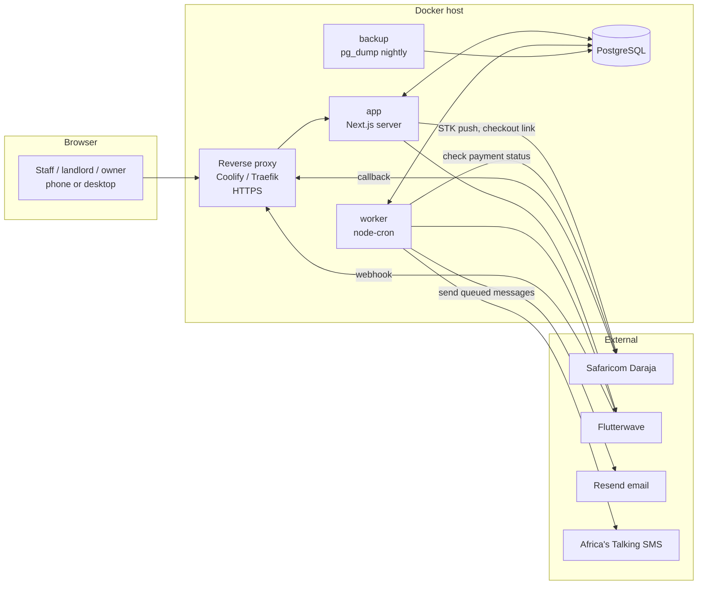
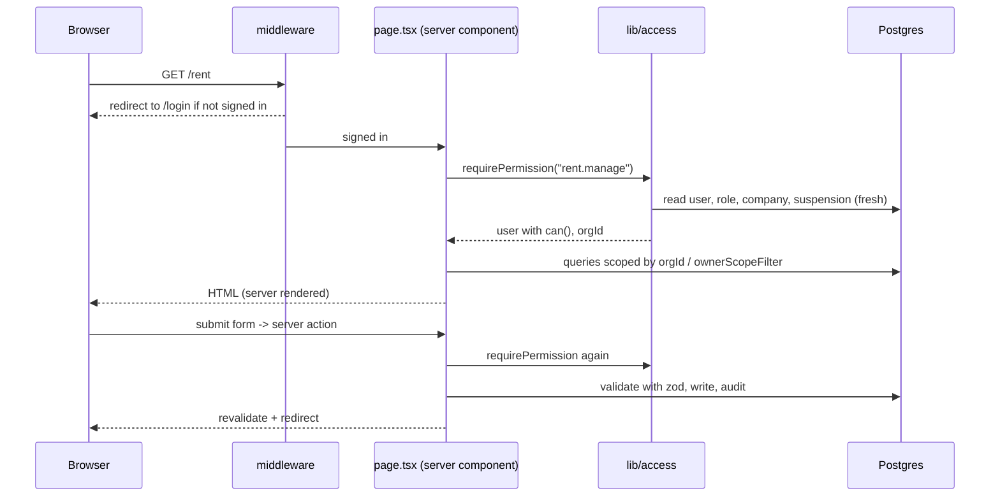

# Architecture

## The pieces



| Process | Image | Job |
|---|---|---|
| `app` | the one Docker image, `node server.js` | Serves pages, runs server actions, receives payment webhooks, streams live updates |
| `worker` | same image, `tsx scripts/worker.ts` | Daily rent job, message delivery, payment reconciliation, heartbeats |
| `db` | `postgres:16-alpine` | All state |
| `backup` | `postgres:16-alpine` | Nightly compressed dump kept 14 days |

The app and the worker share code in `src/lib` but run separately, so the worker can be restarted or fail without taking the site down. Both talk only to Postgres; nothing is in memory that matters.

## Repository layout

```
prisma/
  schema.prisma            the data model (38 models)
  migrations/              SQL migrations, applied on app start
  seed.ts                  admin user + sample property (idempotent)
src/
  app/
    (app)/                 signed-in screens: one folder per feature
      rent/ maintenance/ payouts/ books/ chat/ insights/ platform/ ...
        page.tsx           a server component that reads data and renders
        actions.ts         "use server" functions: the only way data changes
    api/                   route handlers: auth, photos, health, live, payment webhooks
    login/ signup/ pay/ v/ public pages
  components/              shared UI (client components marked "use client")
  lib/                     business logic and helpers (see below)
  middleware.ts            redirects signed-out visitors; lists the public paths
scripts/
  worker.ts                the background worker
  payments-test/ platform-test/ isolation-test/   end-to-end tests
  docs/                    demo data and screenshot tooling
docs/                      all documentation
```

### `src/lib` at a glance

| File | Purpose |
|---|---|
| `access.ts`, `permissions.ts` | Who is signed in, what they may do, which records they may see |
| `auth.ts` | Auth.js configuration, lockout, suspended-company check |
| `prisma.ts` | The shared database client |
| `audit.ts` | Write an activity-log entry |
| `plans.ts`, `plan-catalog.ts` | Plan limits and prices (the catalogue is pure data) |
| `notify.ts`, `notify-events.ts` | The message outbox and the events that create messages |
| `books.ts`, `analytics.ts` | Cash-book assembly and the Insights calculations |
| `chat.ts` | Chat's keyword interpreter |
| `payments/` | M-Pesa, Flutterwave, encryption, reconciliation, webhooks |
| `platform.ts`, `platform-ops.ts` | The admin console's queries and support actions |
| `live.ts` | The change signal behind live updates |
| `payroll.ts`, `checklists.ts`, `reliability.ts`, `usage-alerts.ts` | Domain helpers |
| `whatsapp.ts`, `mpesa-parse.ts` | Phone formatting, tap-to-send links, reading M-Pesa SMS |
| `heartbeat.ts`, `paging.ts` | Worker check-ins, list pagination |

Files used by the worker (`notify.ts`, `payments/*`, `heartbeat.ts`, `plan-catalog.ts`) use **relative imports only** and take the database client as a parameter, because the worker has its own client and no Next.js path aliases.

## How a request flows



Key points:
- **Pages and actions both check permission.** Hiding a button is never the protection.
- **Access is read from the database on every request** (cached within one request), so suspensions and role changes apply instantly even though sessions last 90 days.
- **Server actions are the write path.** They validate input with Zod, check access, write, call `audit()` for sensitive changes, then `revalidatePath` and `redirect`.
- **Errors you expect** (bad input) become a redirect with a message in the query string; **errors that should not happen** throw.

## Cross-cutting designs

**Multi-tenancy.** Every business record belongs to an `Organization`, directly (`orgId`) or through a parent (a Payment belongs to a Lease, to a Unit, to a Property, to an org). Queries filter by company; landlords and owners are narrowed further by `ownerScopeFilter`. See [authentication and permissions](auth-and-permissions.md).

**Outbox for messages.** Code that wants to tell someone something writes a `Notification` row; the worker delivers it, with retries. Business actions never wait for, or fail because of, a message provider. See [background jobs](background-jobs.md).

**Reconciliation for money.** Online payments are recorded as a `PaymentIntent` first and completed exactly once by a guarded transaction, whether the news arrives by webhook or by the worker's status check. See [payments](../payments.md).

**Live updates.** `/api/live` is a server-sent-events stream that only says "something changed" (a cheap query every 4 seconds per open tab). The page then re-reads through its normal code. No data crosses the stream, so there is nothing to leak.

**Plan limits.** `orgStatus()` decides trial, subscribed or lapsed; paid-only features call `assertPremium`/`hasPremium`; unit counts are checked by `assertCanAddUnits`.

**Documents are printable pages.** Receipts, invoices, statements, payslips and certificates are normal pages with a print button, so there is no PDF library.

## Decisions worth knowing

| Decision | Why |
|---|---|
| Server actions, no REST API | One less layer; permissions live next to the data |
| Permissions, not roles, in code | Companies build their own roles without code changes |
| One image for app and worker | Simple to build and deploy; the command differs |
| Postgres only (no Redis, queue or search) | Fewer moving parts at this scale; advisory locks and an outbox table cover the needs |
| Polling for live updates | Needs no extra infrastructure; replace with `LISTEN/NOTIFY` if many hundreds of simultaneous users |
| Chat is keyword matching | Predictable, free, explainable; no AI service dependency |
| No tenant login yet | Focus on the people who do the work; a tenant portal is a planned addition |
| Webhooks never trusted alone | Provider callbacks can be forged or replayed; the provider's own API is the authority |
| Support cannot impersonate | Privacy and trust; support actions are logged in the customer's own activity log |
