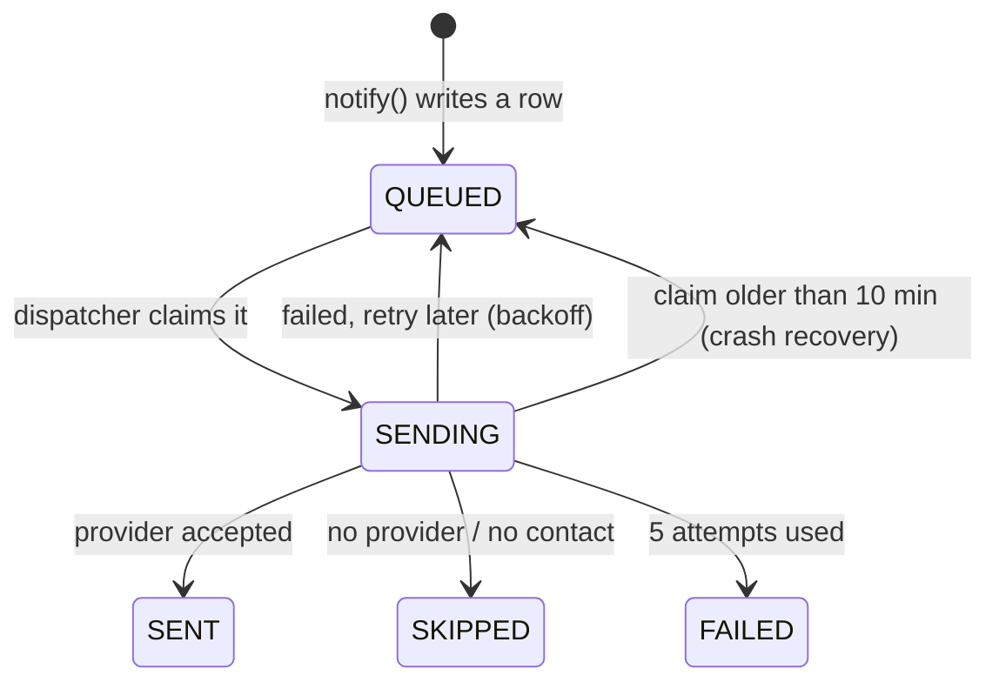

# Background jobs

All background work runs in one process, the **worker** (`scripts/worker.ts`, started with `npx tsx scripts/worker.ts`; the `worker` service in `docker-compose.yml`). It has its own Prisma client and uses only relative imports (no Next.js path aliases).

## Schedule

| When | Job | What it does |
|---|---|---|
| At start (retried up to 10 times, 15 s apart) and daily at **00:05** | **Daily job** | Creates this month's Pending rent row for every active lease that has none; flags overdue Pending rent as Late and tells the tenant; sends staged rent reminders; lease-expiry notices (60 days); plan and trial expiry notices to admins |
| Every minute | **Dispatch** | Delivers queued email and SMS (see outbox below) |
| Every minute | **Heartbeat** | Records that the worker is alive |
| Every 2 minutes | **Payment reconcile** | Asks M-Pesa/Flutterwave about unfinished online payments; completes or expires them |

The retry at start matters on a fresh deploy: the worker can start before the app has finished applying migrations, so the first run may fail until the schema exists.

## Safe to repeat, safe to double-run

Every step is idempotent, and the daily job also takes a lock so two workers do not both do the work:

- **Rent generation** checks which leases already have a payment this month (one query), then inserts the rest in batches of 500.
- **Messages** carry a `dedupeKey` (for example `RENT_REMINDER:<paymentId>:late3`). A second attempt to create the same message violates a unique index and is ignored.
- **The daily lock** is a Postgres advisory lock held in a transaction (`pg_try_advisory_xact_lock(727401)`); a second worker skips the run. The lock is released automatically if the process dies.
- **Payment completion** is a single guarded transaction (see [payments](../payments.md)).

When you add a job, make it repeat-safe first. Then give it a lock key if two copies running at once would do harm.

## The notification outbox (`src/lib/notify.ts`)



- Code that wants to tell someone something calls `notify(db, { event, to, subject, body, dedupeKey })`. It writes a row for the recipient's preferred channel and returns. **A business action never waits for, or fails because of, a message provider.**
- `dispatchQueued()` runs every minute. It first releases stale claims, then claims each due row (`QUEUED` to `SENDING` with an atomic `updateMany`, so two dispatchers never send the same row), then sends.
- A failed send is retried after 1, 2, 4 and 8 minutes (`attempts`, `nextAttemptAt`) and becomes `FAILED` on the fifth failure. Provider calls time out after 15 seconds.
- **WhatsApp** rows stay `QUEUED` for a person to send by tapping a `wa.me` link (`whatsapp.ts`); the dispatcher skips them.
- With no provider configured, rows are marked `SKIPPED` so the log still shows what would have been sent.
- Providers are plain HTTP calls: Resend (`RESEND_API_KEY`, `NOTIFY_EMAIL_FROM`), Africa's Talking (`AT_USERNAME`, `AT_API_KEY`, optional `AT_SENDER_ID`).

Events that create messages live in `src/lib/notify-events.ts` (payment received, payout sent, maintenance assigned/done, supplier paid, and so on). The scheduled ones (late rent, reminders, expiries) are in the worker.

## Heartbeats

`beat(db, name, info?)` (`src/lib/heartbeat.ts`) upserts a `SystemHeartbeat` row. The worker writes `worker` (every minute and at start), `daily-job` (after each successful daily run) and `payments-reconcile` (after each reconcile pass). The [admin console](../admin-console.md) turns these into health lights: red after 3 minutes of silence for the worker.

## Adding a scheduled job

1. Write the function in `scripts/worker.ts` (or a relative-import module it calls) taking the worker's `prisma` client.
2. Make it idempotent. Use a `dedupeKey` for messages; check before you insert.
3. Add it to `runDailyJob()` for daily work, or `cron.schedule(...)` for other cadences. Guard against overlapping runs of the same job (see the `reconciling` flag).
4. Catch and log errors so one failing job does not stop the others.
5. Write a heartbeat if operators should be able to see it is running, and show it in `systemHealth()` in `src/lib/platform.ts`.
6. Update the schedule table above and the worker section of [deployment](../deployment.md).

## Running it locally

```sh
npx tsx scripts/worker.ts
```

You should see `[worker] started`. To exercise a job without waiting, call its function from a one-off script with a `PrismaClient`, as the end-to-end tests do (`scripts/payments-test/run.ts` calls `reconcilePending` directly).
