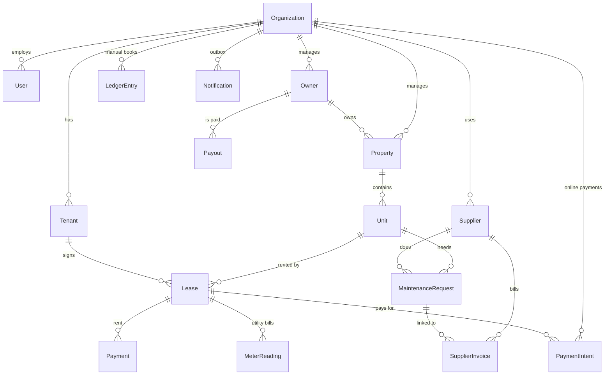

# Data model

The schema is `prisma/schema.prisma` (38 models, 22 migrations). This page is the map; the schema is the truth.

## The core, at a glance

**The ownership chain to remember:** `Organization` to `Property` to `Unit` to `Lease` to `Payment`. A payment has no `orgId` of its own; it belongs to a company through its lease, unit and property. Queries that reach a payment filter through that chain (`lease: { unit: { property: { orgId } } }`).

## Models by area

| Area | Models | Notes |
|---|---|---|
| **Identity and company** | `User`, `Account`, `Session`, `VerificationToken`, `Organization`, `OrgRole`, `AuditLog` | `Organization` holds the plan, trial and paid-until dates, suspension, pay instructions and approval limit. `OrgRole.permissions` is a string array |
| **Portfolio** | `Owner`, `Property`, `Unit`, `Tenant`, `Lease`, `Photo`, `AccessCode`, `Booking` | `Property.managementMode` is `AGENCY_MANAGED` or `SELF_MANAGED`; `commissionPct` is the agency's cut |
| **Rent and utilities** | `Payment`, `PaymentProof`, `UtilityMeter`, `MeterReading` | `PaymentProof` is a pasted M-Pesa SMS awaiting approval; `MeterReading.alert` flags unusual usage |
| **Online payments** | `PaymentSettings`, `PaymentIntent` | One settings row per company with encrypted secrets; one intent per attempt |
| **Money out** | `Payout`, `SupplierInvoice`, `Employee`, `PayrollRun`, `Payslip`, `LedgerEntry` | `LedgerEntry` holds only the entries a person typed into Books |
| **Agents** | `Agent`, plus `Lease.agentId/source/agentCommission*` | The commission is copied onto the lease when it is created, so later rate changes do not rewrite history. Paying one sets `agentCommissionPaidAt` and writes an "Agent commission" `LedgerEntry` |
| **Repairs** | `Supplier`, `MaintenanceRequest`, `MaintenanceSchedule` | A request's `actualCost` is charged to the owner's payout |
| **Move in and out** | `Checklist`, `ChecklistItem` | One checklist per lease and type (`MOVE_IN`, `MOVE_OUT`) |
| **Communication** | `Notification`, `ChatMessage` | `Notification` is the outbox; `ChatMessage.data` holds the tap-to-confirm options |
| **Marketplace** | `ServicePartner`, `ServiceLead` | Referral leads and commissions |
| **Platform operations** | `SupportNote`, `SystemHeartbeat` | PropCo-internal |

## Conventions

- **IDs** are `cuid` strings. A few legacy rows use readable ids (`org_default`).
- **Money** is `Decimal` (`@db.Decimal(12, 2)` mostly, `10,2` on older rent columns). Convert with `Number()` only for display or comparison, and round to 2 places with `Math.round(n * 100) / 100` when you compute.
- **Dates** are `DateTime` in UTC. "This month" boundaries in the UI use the server's calendar; the Books page uses UTC months.
- **Enums** are Prisma enums for fixed sets (statuses, roles, channels) and plain strings for open sets (`method`, `category`).
- **Status machines:** `Payment` (PENDING, PAID, LATE, FAILED), `MaintenanceRequest` (OPEN, ASSIGNED, IN_PROGRESS, DONE, CANCELLED), `SupplierInvoice` (SUBMITTED, APPROVED, REJECTED, PAID), `PayrollRun` (DRAFT, APPROVED, PAID), `PaymentIntent` (PENDING, SUCCESS, FAILED, CANCELLED), `Notification` (QUEUED, SENDING, SENT, FAILED, SKIPPED).
- **Indexes** exist for the hot queries (company plus status or date). When you add a query that filters a big table in a new way, add an index in the same migration.
- **Deleting**: prefer status changes over deleting rows that money depends on. `PaymentIntent` rows are never deleted.

## Migrations

- Change `schema.prisma`, then `pnpm db:migrate --name what_changed` to create `prisma/migrations/<timestamp>_what_changed/migration.sql`. Commit both.
- Check the SQL. For new enum values Prisma writes `ALTER TYPE ... ADD VALUE`, which is fine on its own but cannot be used in the same migration that adds it.
- Migrations are **applied automatically on app start** (`docker-entrypoint.sh`), so they must be safe to run against production data: add columns as nullable or with defaults.
- Never edit a migration that has been applied anywhere. Add a new one.
- To confirm the migrations and the schema agree: `pnpm prisma migrate diff --from-migrations prisma/migrations --to-schema-datamodel prisma/schema.prisma --shadow-database-url <a scratch database> --script` should print "This is an empty migration."

## Adding a field or a model: checklist

1. Edit `schema.prisma` and create the migration.
2. If it belongs to a company, make sure queries filter by it (directly or through the chain) and add it to the isolation test if it is a new top-level record.
3. Add an index if you will filter or sort a large table by it.
4. If it is user-visible, update the [user guide](../user-guide/README.md) and re-run the screenshots.
