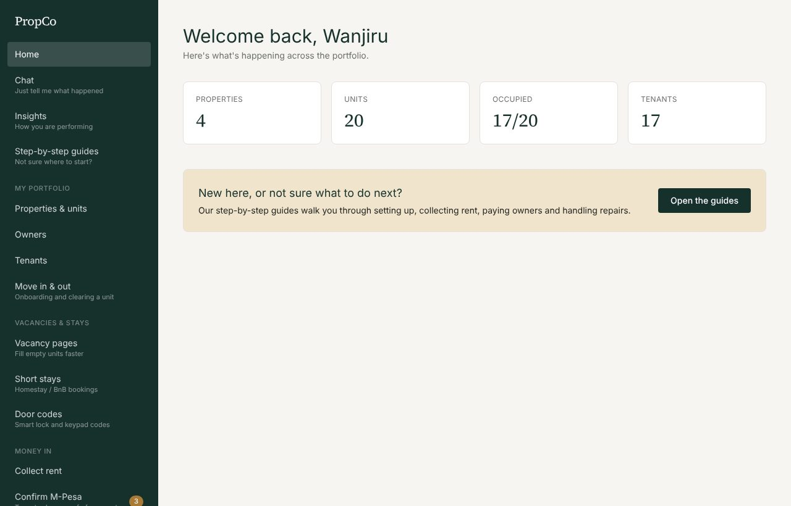

# PropCo: product overview

PropCo is a property management platform built for Kenyan agencies and landlords. It runs the whole monthly cycle in one place: collect rent, handle repairs, pay owners, keep the books, and stay on top of tenants, from a phone or a desktop.

## Who it is for

| Customer | What they need | What PropCo gives them |
|---|---|---|
| **Property management agency** (manages buildings for other people) | Collect rent for many owners, take a commission, report to owners, run a team | Agency-managed properties, owner payouts with statements, staff roles, activity log |
| **Self-managing landlord** | Know who has paid, chase late rent, handle repairs, keep it simple | A scoped account that only shows their own properties; the same rent, repairs and books tools |
| **Property owner** (client of an agency) | See what is happening with their property and money | A read-only view of their own properties, repairs and payouts, with printable statements |
| **PropCo staff** | Run the SaaS business: monitor health, support customers, bill them | The [admin console](../admin-console.md) |

## The problem it solves

Most small managers run on WhatsApp groups, M-Pesa messages and a spreadsheet. Rent gets lost between a text message and a notebook, owners ask "where is my money?", and repairs are paid twice or not at all. PropCo keeps one trusted record, and meets people where they already work: WhatsApp and M-Pesa.

## What it does

### Money in
- **Rent roll** with a status for every tenant this month (Paid, Pending, Late), updated nightly.
- **Record any payment** (M-Pesa, bank, cash, card) with a reference; printable **receipts** and **invoices/statements**.
- **Confirm M-Pesa**: paste the tenant's confirmation SMS and PropCo reads the code, amount and payer, matches the tenant by phone, and blocks any code being used twice.
- **Online payments**: send the tenant an M-Pesa prompt (Safaricom Daraja STK Push) or a card/bank/mobile-money link (Flutterwave). Payments reconcile themselves; lost confirmations are recovered automatically. See [payments](../payments.md).
- **Utilities**: meters per unit (water, electricity, internet), monthly readings, automatic bills with unusual-usage alerts.
- **Staged reminders**: 3 days before, on the day, and 3 and 7 days late, by SMS, email or WhatsApp.

### Money out
- **Owner payouts**: monthly, from rent collected less your commission and repair costs, with a printable statement per owner.
- **Supplier invoices**: enter, approve (with a company approval limit), pay. Approved repair invoices charge the right owner.
- **Repairs**: log against a unit, assign a supplier, add photos, record the real cost, plus a preventive maintenance calendar.
- **Payroll** (paid plans): salaries with PAYE, NSSF, SHIF and housing levy, payslips, and a "to pay the authorities" summary.

### Know where you stand
- **Books**: a cash book that combines paid rent, invoices, salaries and payouts with anything you type in; monthly profit; CSV for your accountant.
- **Insights**: occupancy, collection rate, unpaid rent by age, cost of empty units, leases ending soon, property-by-property performance, and a rental income tax estimate.

### Tenants and vacancies
- Tenants, leases, **move-in and move-out checklists** (condition, damage charges, deposit settlement, clearance certificate).
- **Vacancy pages** you can share on WhatsApp, **short stays** (homestay/BnB bookings with door codes), and a **services marketplace** (insurance, cleaning, security and more).

### Working the way people already work
- **Chat**: type "John paid rent 25000 mpesa" or "Leak in unit 4B" and tap to confirm. See the [Chat guide](../user-guide/02-chat.md).
- **WhatsApp**: reminders and receipts open in WhatsApp with the message ready; no business account needed.
- **Phone first**: big buttons, a bottom bar, installable as an app, stays signed in for 90 days.
- **Live**: pages refresh themselves when a payment or message arrives.

### Running a team safely
- Permission-based access with **custom roles** (accountant, caretaker), suspend people instantly, lockout after repeated wrong passwords, forced password change for temporary passwords, and an **activity log** of who changed what.

## Plans and pricing

Prices in Kenyan shillings, per month. Everything is unlocked during the 14-day free trial.

| Plan | Units | Price (KES) |
|---|---|---|
| Free | up to 5 | 0 |
| Growth | up to 50 | 2,500 |
| Pro | up to 250 | 7,500 |
| Scale | unlimited | 15,000 |

Utilities, move-in/out checklists, door codes, short stays and payroll are available during the trial and on paid plans; on the Free plan they are switched off. Prices live in one file (`src/lib/plan-catalog.ts`). Customers pay online (M-Pesa or card) or by paying PropCo's till and sharing proof; PropCo staff can also activate a plan by hand.

## How it is built, in brief

A web application (Next.js and PostgreSQL) in Docker containers: the app, a background worker, the database and a nightly backup. Every company's data is kept strictly separate. See the [developer guide](../developer/README.md).

## Integrations

| Service | Used for | Required? |
|---|---|---|
| Safaricom Daraja | M-Pesa prompts to tenants' phones | Optional, per company |
| Flutterwave | Cards, bank, mobile-money links | Optional, per company |
| Resend | Email messages | Optional |
| Africa's Talking | SMS messages | Optional |
| WhatsApp (tap-to-send links) | Reminders, receipts, vacancy sharing | Works with no setup |
| Google sign-in | Sign in with Google | Optional |

Nothing here uses AI services. Chat is keyword matching.

## Security and privacy in brief

- Each company can only ever see its own data; this is checked on every request and covered by an automated isolation test.
- Payment-provider keys are encrypted in the database. Card details never touch PropCo.
- Online payments are confirmed with the provider before any money is recorded; duplicates are harmless.
- PropCo support actions are visible to the customer in their own activity log, and there is no "sign in as the customer" feature.
- Nightly backups, a health check, and an admin console that shows when background work stops.

## Known limits and what is next

| Today | Next |
|---|---|
| Tenants cannot sign in; staff and owners do | Tenant portal (pay, see receipts, log repairs) |
| No self-service "forgot password" (support or the company admin issues a temporary password) | Email reset link |
| Paybill payments made from the tenant's own phone menu are recorded with *Confirm M-Pesa* | Daraja C2B so they record themselves |
| Chat understands a fixed set of phrases | More phrases; no AI is planned |
| No contract or document store; no scheduled/exported reports | Documents and report exports |
| Only Safaricom and Flutterwave for online payments | Paystack, Pesapal (the code is built to add them) |
| English only | Swahili |

## Glossary

| Term | Meaning |
|---|---|
| **Agency-managed** | The company collects rent for an owner and takes a commission |
| **Self-managed** | A landlord manages their own property |
| **Rent roll** | The list of every active tenant with this month's rent status |
| **Payout** | What the company owes an owner for a month: rent collected, less commission and repairs |
| **Proof of payment** | The M-Pesa confirmation SMS a tenant forwards |
| **Intent** | One attempt to collect money online (internal term) |
| **Platform admin** | PropCo staff who use the admin console |
