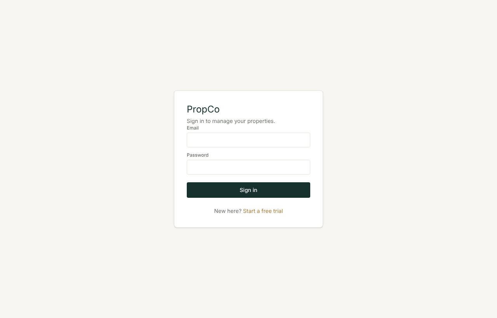
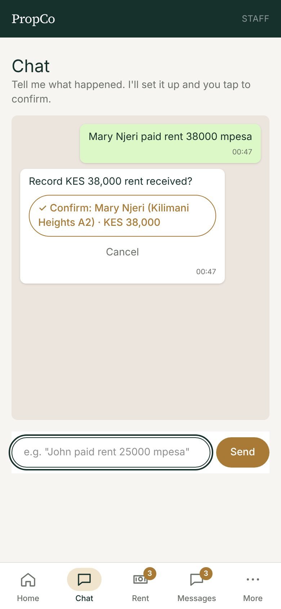

# 1. Getting started

## Sign in

Open your PropCo address and sign in with your email and password (or **Continue with Google** if your company uses it).

- If you were given a **temporary password**, PropCo asks you to choose your own straight away. Pick something only you know.
- Five wrong passwords in a row lock your account for 15 minutes. Wait, or ask your administrator to unlock it.
- You stay signed in on your phone for 90 days.

## Your home screen

After you sign in you land on **Chat** (see the [Chat guide](02-chat.md)). **Home** shows the headline numbers: properties, units, how many are occupied, and tenants.

## The menu

The menu is grouped by what you are trying to do.

| Group | What is in it |
|---|---|
| (top) | **Home**, **Chat**, **Insights**, **Step-by-step guides** |
| **My portfolio** | Properties and units, Owners, Tenants, Move in and out |
| **Vacancies and stays** | Vacancy pages, Short stays, Door codes |
| **Money in** | Collect rent, Confirm M-Pesa, Water/power/internet |
| **Money out** | Owner payouts, Supplier invoices, Pay suppliers, Books |
| **Repairs** | Repair requests, Preventive calendar, Suppliers, Services and insurance |
| **Communication** | Messages |
| **Account** | Payroll, Online payments, Team and roles, Plan and billing, My account |

Small orange numbers show work waiting for you: M-Pesa proofs to confirm, WhatsApp messages to send, preventive jobs overdue.

## Using PropCo on your phone

Most people use PropCo on a phone. The bottom bar has the four jobs you do daily plus **More** for everything else.

Install it like an app: when you see the **Install app** banner, tap it. On an iPhone, use Safari's **Share** button, then **Add to Home Screen**.

## First-day checklist

If you are starting a new company, do these in order. Each one is a few minutes. The in-app **Step-by-step guides** walk through them too.

1. **Add an owner** (the person you pay rent to). Skip this if you manage your own property. [How](03-properties-owners-tenants.md#add-an-owner)
2. **Add a property** and its **units** (flats or rooms).
3. **Add your tenants** with a phone number each, and **move them in** to their units.
4. **Add suppliers** (plumber, electrician, and so on).
5. Under **Team and roles**, set **Company details**: how tenants should pay you (shown on invoices) and your supplier approval limit. [How](10-team-and-security.md#company-details)
6. Optional: turn on [online payments](11-settings-and-billing.md).
7. Each month: [collect rent](04-collecting-rent.md), then [pay owners](06-owner-payouts.md).

## Who can see what

Your **role** decides what appears in your menu.

| Role | Typical person | Can do |
|---|---|---|
| **Admin** | Company owner or manager | Everything, including team, billing and payroll |
| **Staff** | Agent, caretaker | Day-to-day work: rent, repairs, tenants, payouts, invoices. Not payroll, billing, team or books |
| **Custom role** | Accountant, caretaker, and so on | Exactly what your admin ticks for them |
| **Landlord** | Self-managing landlord | Everything for their own properties only |
| **Owner** | Client of an agency | A read-only view of their own properties, repairs and payouts |

Details in [Team and security](10-team-and-security.md).
