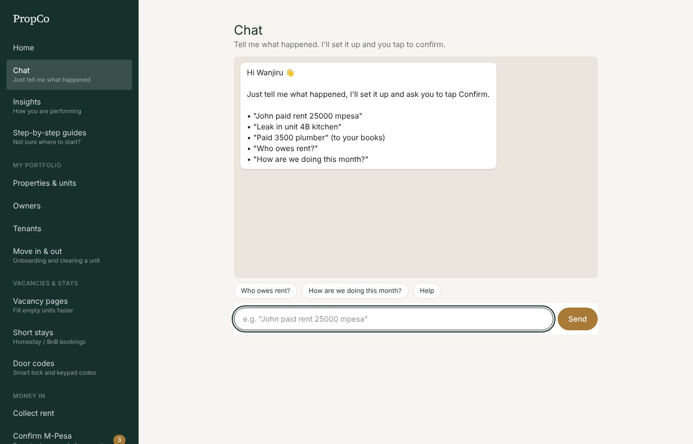
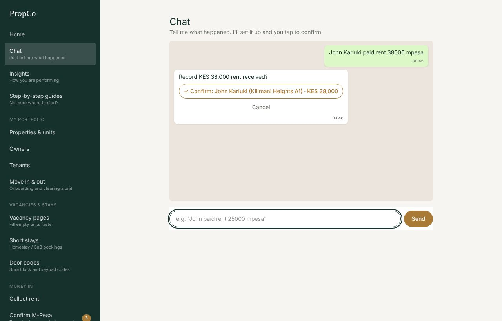
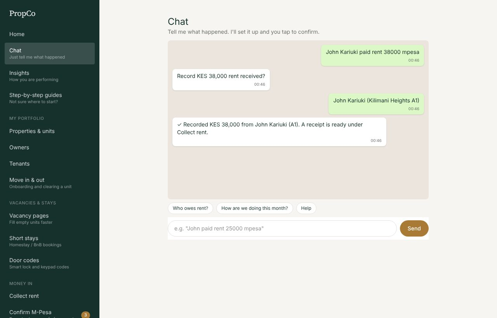
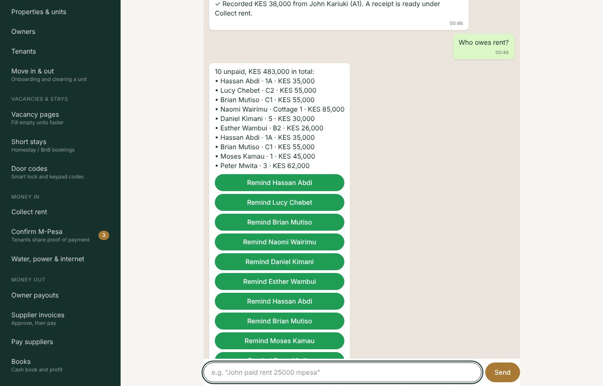
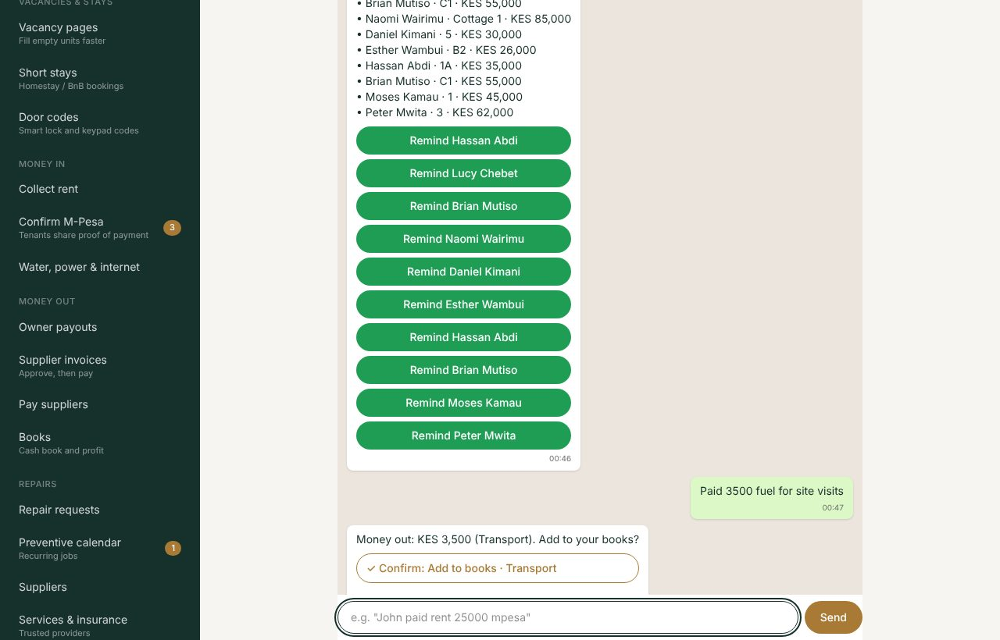
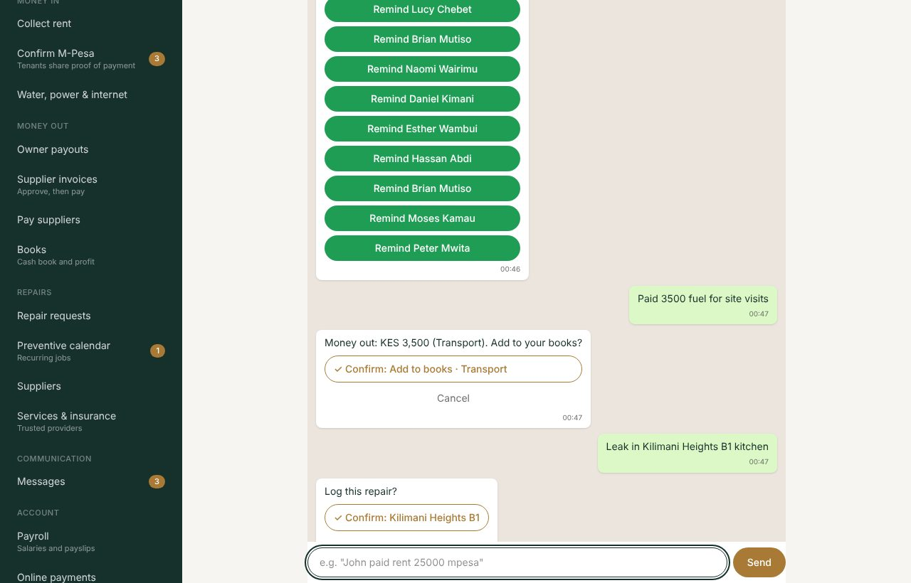

# 2. Chat: do it by typing

Chat is the quickest way to do everyday jobs. You type what happened in plain words, PropCo works out what you mean and asks you to **tap to confirm**. **Nothing is saved until you tap.**

## Record a rent payment

1. Type: `John Kariuki paid rent 38000 mpesa`
2. PropCo finds the tenant and shows a button to confirm.
3. Tap **Confirm**. The rent is marked paid, the owner is told, and a receipt is ready.

If your words match more than one tenant or unit, PropCo shows one button for each and you tap the right one. If it is wrong, tap **Cancel**.

Add the M-Pesa code to the message to save it with the payment: `John paid rent 38000 mpesa RGT4K9X2QA`. Say `cash` or `bank` for other methods.

## See who owes rent

Type `Who owes rent?` PropCo lists everyone unpaid and gives you a green **Remind** button for each. Tap one and WhatsApp opens with a polite reminder ready to send.

## Add to your books

Type something with an amount and a word that says what it was: `Paid 3500 fuel for site visits`. PropCo picks the category (here, Transport) and asks you to confirm.

## Log a repair

Type `Leak in Kilimani Heights B1 kitchen`. Mention the unit so PropCo knows where.

## Everything Chat understands

| Say this | PropCo does this |
|---|---|
| `John paid rent 25000 mpesa` | Marks that tenant's unpaid rent as paid (or records a payment) |
| `Leak in unit 4B kitchen` | Logs a repair for that unit |
| `Paid 3500 plumber` | Adds an expense to Books |
| `Received 25k deposit` | Adds money in to Books |
| `Add tenant Jane Wanjiru 0712345678` | Adds a tenant |
| `Move Jane into 4B rent 15000 deposit 15000` | Starts a lease and marks the unit occupied |
| `Invoice from Joe 4500 unit 4B` | Adds a supplier invoice for approval |
| `Who owes rent?` | Lists unpaid tenants with reminder buttons |
| `How are we doing this month?` | Money in, money out and profit |
| `Help` | Shows examples |

**Good to know**
- Amounts can be written `25000`, `25,000` or `25k`.
- Chat matches **keywords**; it is not artificial intelligence. If it does not understand, it says so and shows examples. You can always use the normal screens instead.
- Chat uses **your permissions**. If you cannot normally record rent, Chat will not let you either.
- Your chat history is private to you.
- Chat is for staff and landlords. Read-only owners go to Home instead.
