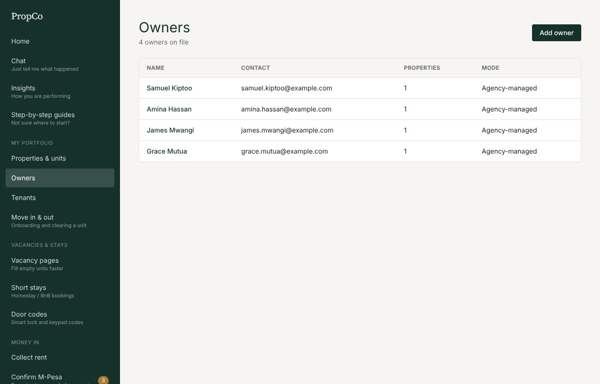
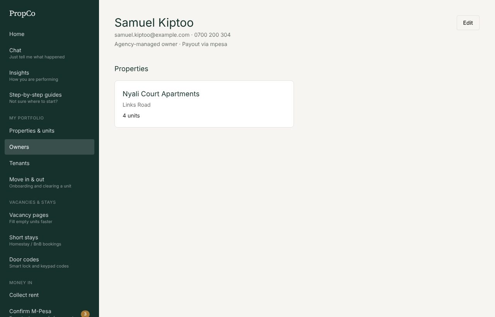
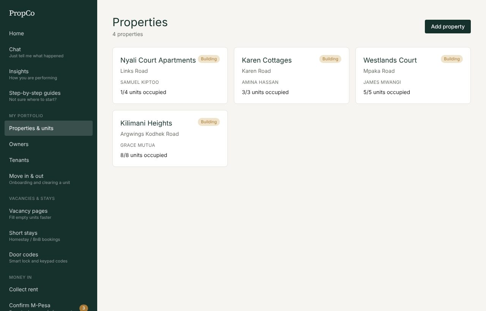
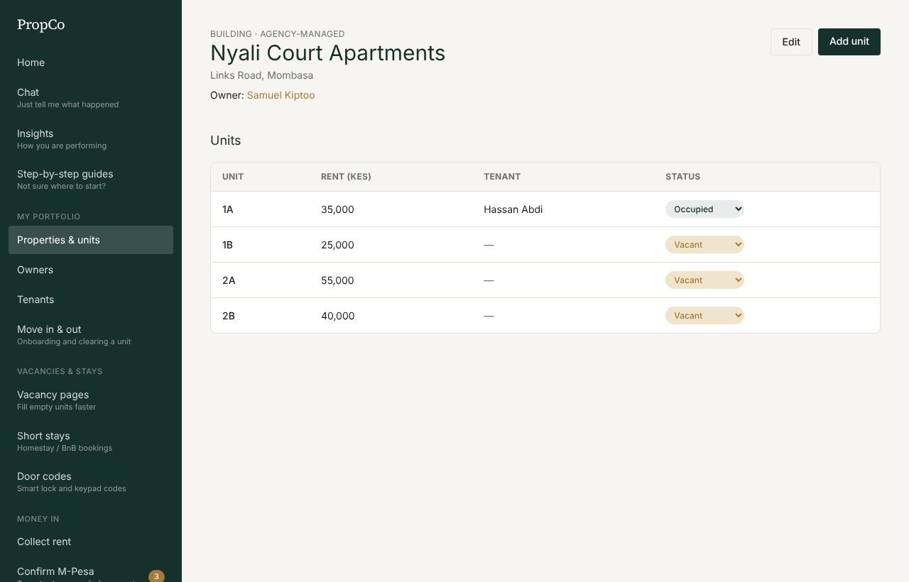
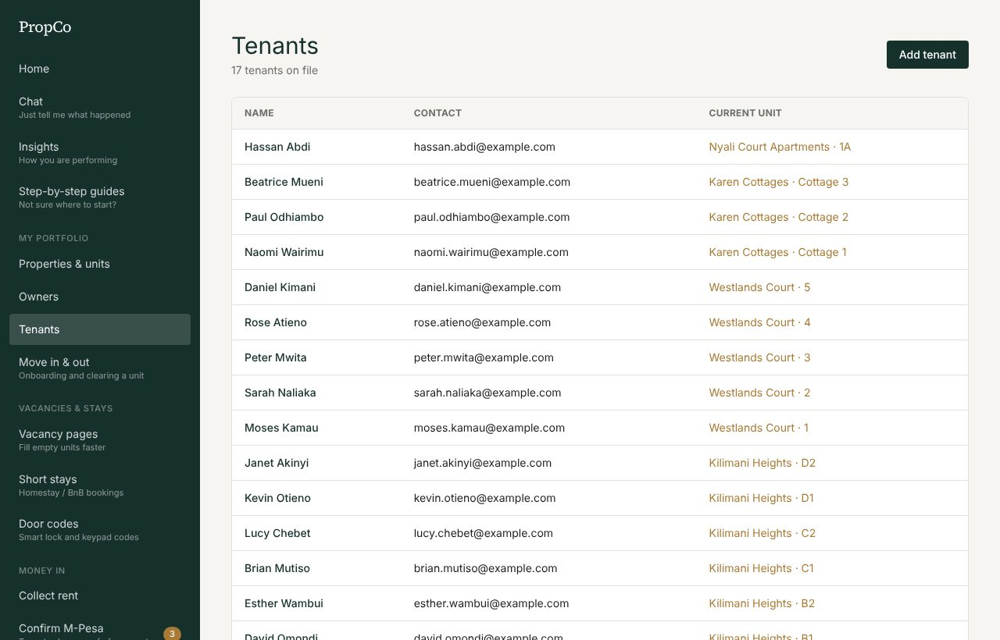
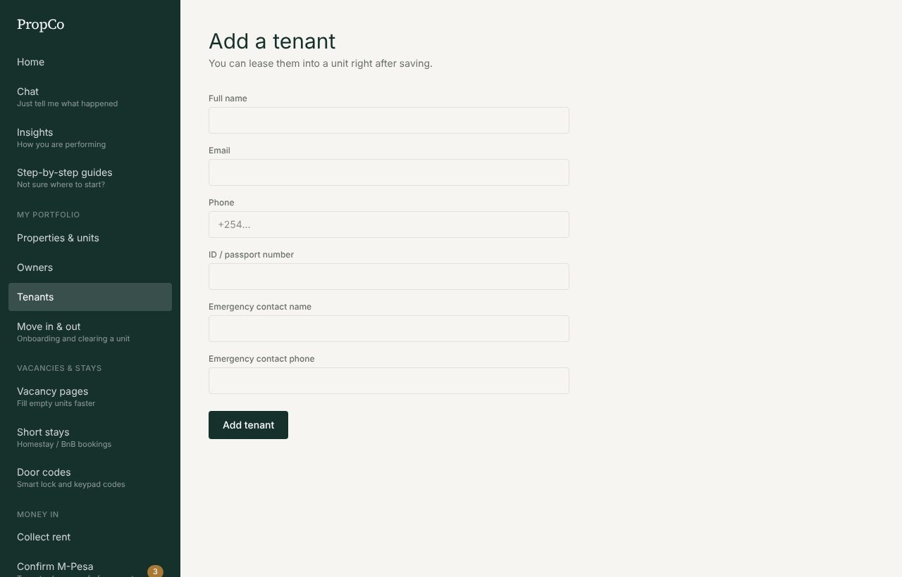
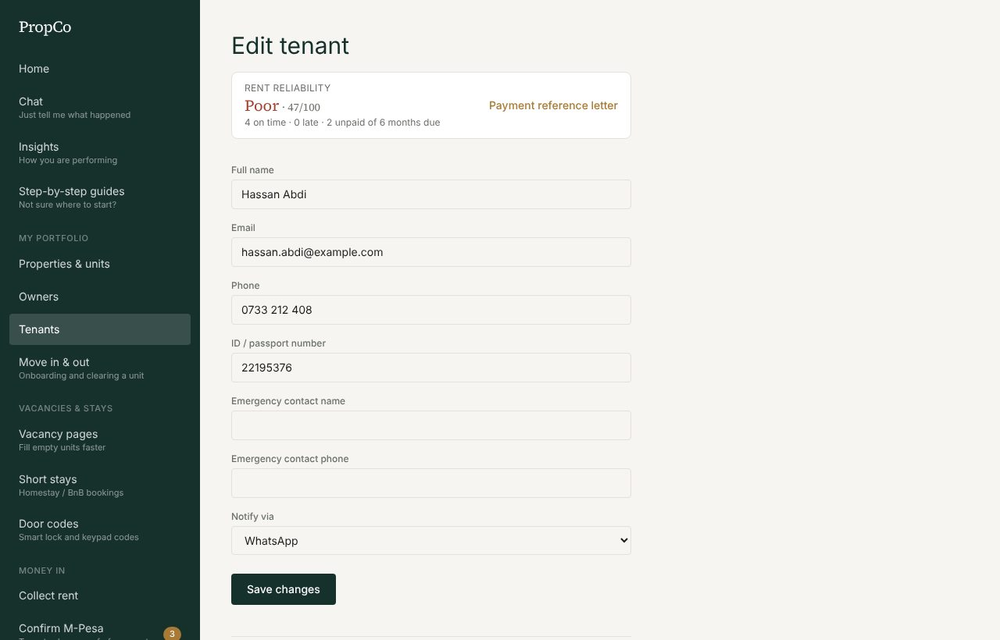
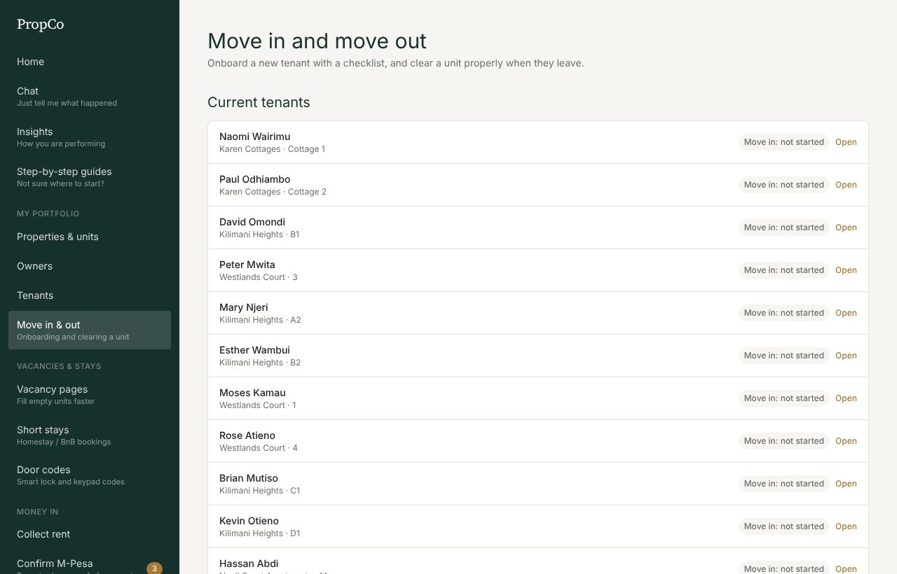

# 3. Properties, owners and tenants

Everything in PropCo hangs off four things: an **owner** owns a **property**, a property has **units**, and a **tenant** rents a unit through a **lease**.

## Add an owner

Skip this if you manage your own property (a self-managing landlord has no separate owner).

1. Open **Owners** and press **Add owner**.
2. Enter their name and phone number, and choose how they want to hear from you: email, SMS or WhatsApp.
3. Optionally add their M-Pesa number or bank details for payouts. Save.

Open an owner to see their properties and payouts.

## Add a property and its units

A property is a building or a house. A unit is the thing a tenant rents, such as "A1" or "Cottage 2". A single house can have just one unit.

1. Open **Properties and units** and press **Add property**.
2. Pick the **owner**, enter the name and address, and set your **commission %** (10% by default; this is what your company keeps from the rent collected).
3. Save, then open the property and press **Add unit** for each flat or room. Give each a name, bedrooms and bathrooms, and the **monthly rent**.

## Add a tenant

Tenants get rent reminders and repair updates, so always add a **phone number**.

1. Open **Tenants** and press **Add tenant**.
2. Enter their name and phone, and choose how to notify them. WhatsApp is popular.
3. Save.

## Move a tenant in (create a lease)

A lease links a tenant to a unit and sets the monthly rent. Rent tracking starts from it.

1. Open the tenant from the **Tenants** list.
2. Scroll to the lease section. Choose the **unit**, the **start date**, the **rent** and (optionally) the **deposit**.
3. Save. The unit becomes **Occupied**, and the tenant appears on the rent roll.

On paid plans and during the trial, you land straight in the **move-in checklist**.

## Move-in and move-out

Open **Move in and out** to see every lease.

**Move in:** record the paperwork and the condition of the unit when the tenant arrives.
1. Choose the tenant and press **Start move-in checklist**.
2. Tick each task, and mark each item **Good**, **Fair** or **Damaged**.
3. Save, then press **Mark move-in complete**.
4. Record the **opening meter readings** (see [Utilities](08-utilities-and-payroll.md)) so the new tenant is only billed for what they use.

**Move out:** inspect, charge for damage, settle the deposit, and free the unit.
1. Record the **final meter readings** first.
2. Open the tenant and press **Start move-out**. Mark each item's condition and type a charge for any damage.
3. Check the **deposit settlement**: deposit, less damage, unpaid utility bills and unpaid rent. A negative number means the tenant still owes you.
4. Press **Complete move-out and clear unit**. The lease ends, the unit is freed (or a repair request is opened), and door codes are cancelled.
5. Print the **clearance certificate** for the tenant to sign.

## Tenant reliability

Each tenant has a payment reference letter showing how reliably they have paid (on time, late, unpaid, average days late). Open the tenant and press **Payment reference letter**. It can be printed for a future landlord or a lender.

## Fill a vacant unit

Open **Vacancy pages**, add your WhatsApp number (enquiries go there), describe the unit, add photo links, tick **Show this page publicly**, and press **Share on WhatsApp**. Anyone can open the link on their phone with no sign-in. Take the page down when the unit is let.

## Short stays and door codes

Run a homestay or BnB under **Short stays** (nightly price, bookings without double-booking, a guest door code, welcome message, turnover cleaning). **Door codes** tracks lock and keypad codes and cancels them at move-out or check-out. These are available during the trial and on paid plans.
