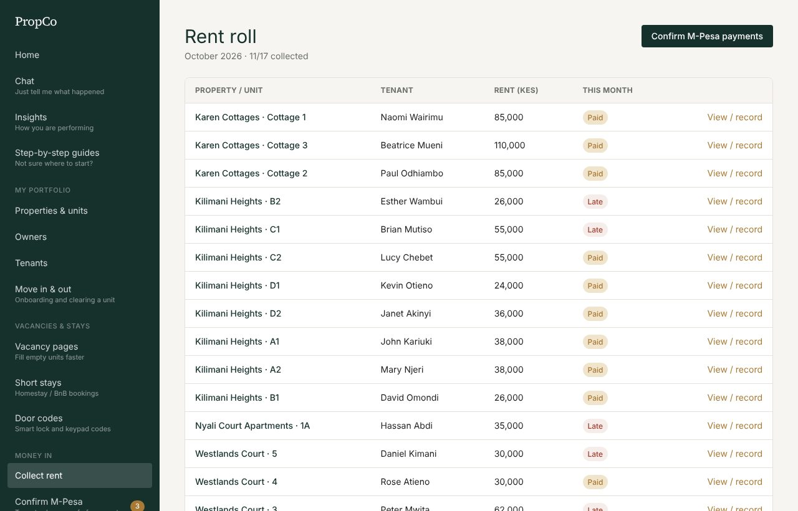
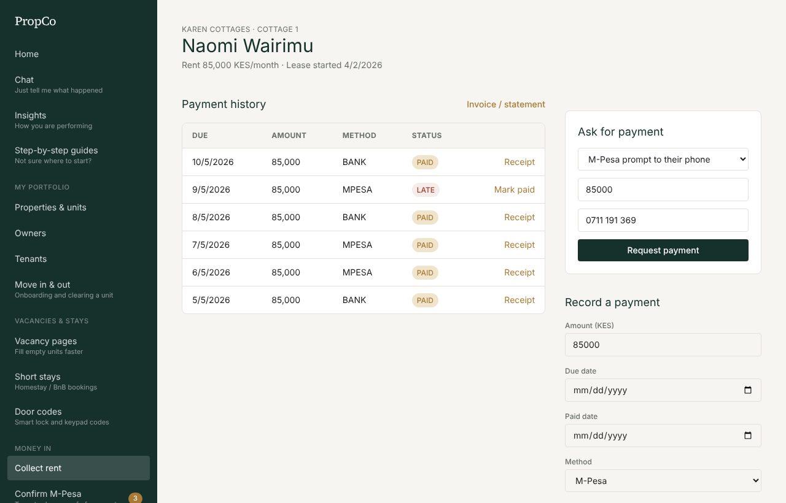
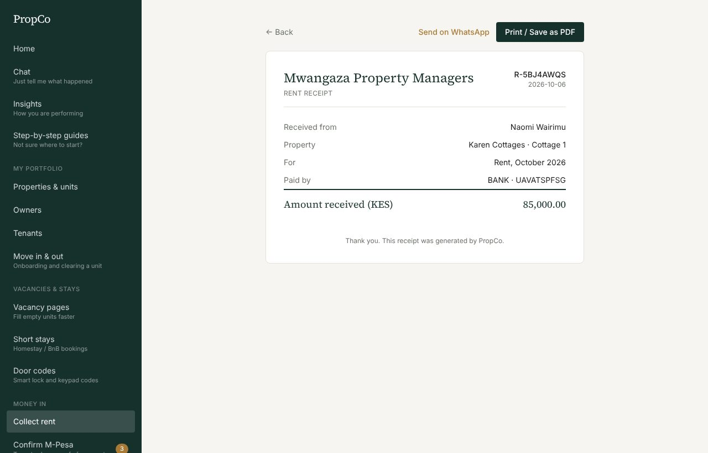
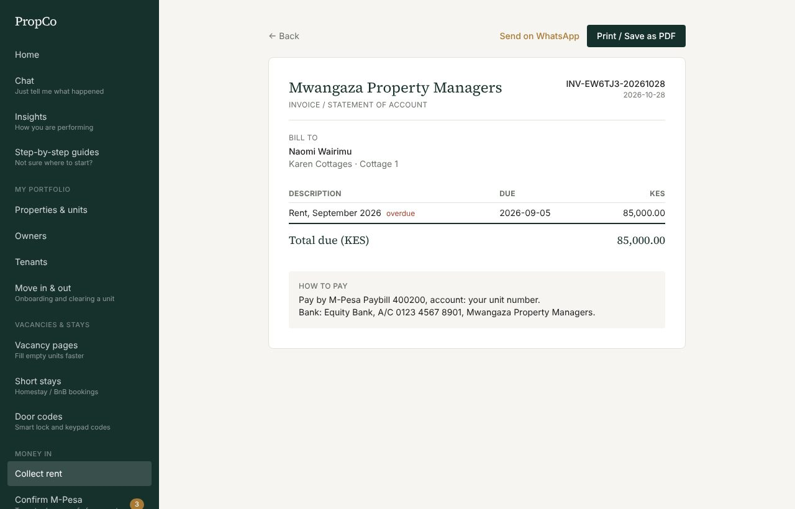
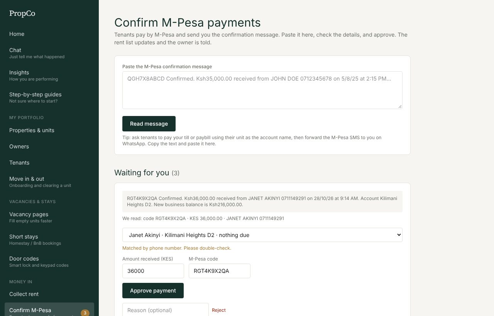

# 4. Collecting rent

## The rent roll

Open **Collect rent**. Every active tenant has a status for this month:

| Status | Meaning |
|---|---|
| **Paid** | This month's rent has been received |
| **Pending** | Not due yet, or due and not yet paid |
| **Late** | Past its due date and still unpaid. PropCo flags these every night |

Press **View / record** on a row to open that tenant's payment history.

## Record a payment

When a tenant pays by M-Pesa, bank or cash, note it so owners get paid correctly.

1. Open the tenant's row.
2. In **Record a payment**, enter the **amount**, **due date**, **paid date**, **method** and **status** (Paid in most cases).
3. Type the **reference** (the M-Pesa code or bank reference).
4. Press **Save payment**. The owner is told automatically.

If a payment already exists as Pending or Late, press **Mark paid** beside it instead.

You can also do this in [Chat](02-chat.md): `John paid rent 38000 mpesa`.

## Receipts and invoices

- Every paid row has a **Receipt**: a printable page you can save as PDF or send on WhatsApp.

- **Invoice / statement** lists unpaid rent and unpaid utility bills, with your "how to pay" instructions (set under Team and roles, Company details).

## Confirm M-Pesa payments

Many tenants pay your till or paybill and send you the M-Pesa message. PropCo turns that message into a payment, safely.

1. Open **Confirm M-Pesa**.
2. Paste the message the tenant sent you and press **Read message**. PropCo reads the code, amount and payer.
3. Under **Waiting for you**, check the details. PropCo picks the tenant by phone number; choose the tenant if it did not.
4. Press **Approve payment**. The rent roll updates and the owner is told. Or **Reject** with a reason.

An M-Pesa code can **never be used twice**, so a repeated or reused message is blocked.

## Ask for payment online

If your company has turned on [online payments](11-settings-and-billing.md), the tenant's page has an **Ask for payment** box:

- **M-Pesa prompt to their phone**: the tenant gets a prompt and enters their PIN. When the money arrives the rent is marked paid by itself and the page updates.
- **Card / bank / mobile money link**: PropCo creates a link. Press **Send on WhatsApp** to send it to the tenant.

The box lists recent requests with their status (pending, success, failed and why).

## Late rent

- Late tenants are messaged automatically: 3 days before the due date, on the due date, and 3 and 7 days late, with a firmer tone each time.
- Open **Messages** to send the waiting WhatsApp messages (see [Messages and WhatsApp](09-messages-and-whatsapp.md)).
- In [Chat](02-chat.md), type `Who owes rent?` for a list with a reminder button for each person.
- **Insights** shows unpaid rent by age so you chase the oldest first. See [Books and Insights](07-books-and-insights.md).
