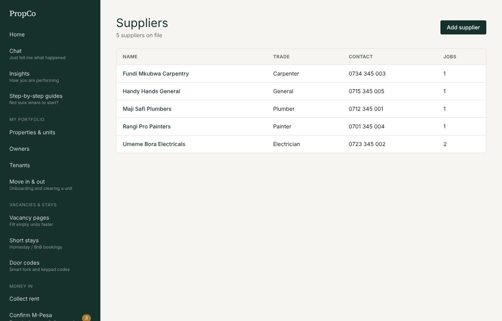
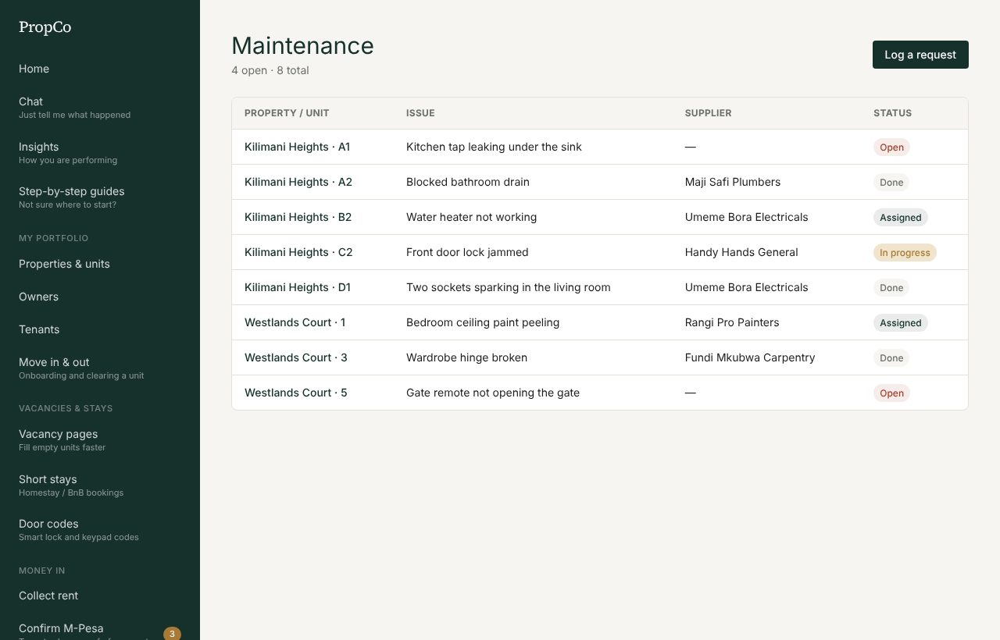
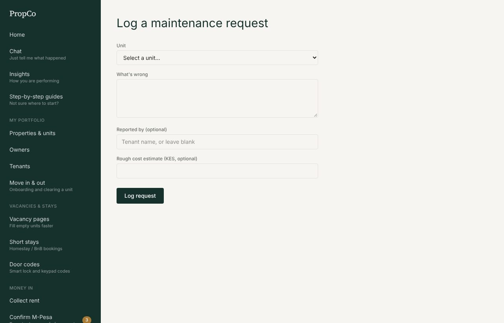
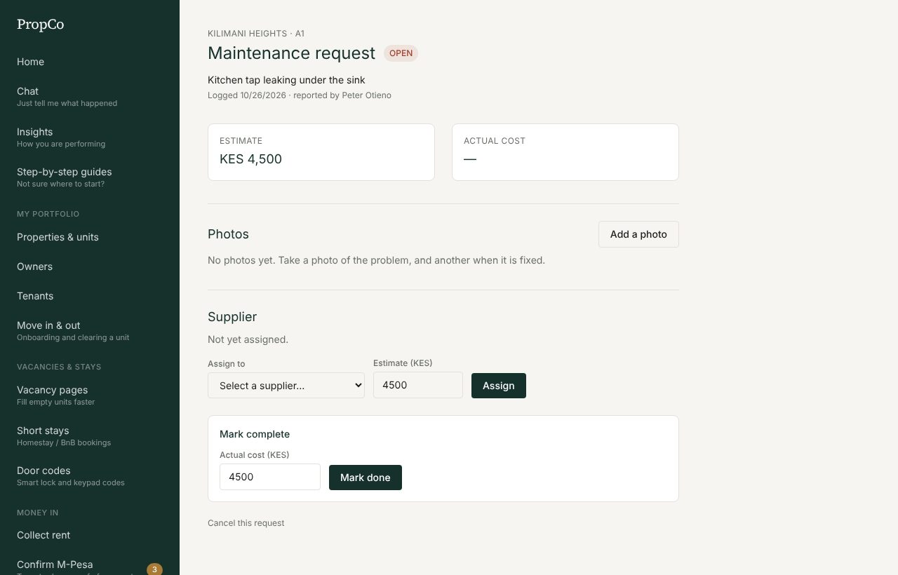
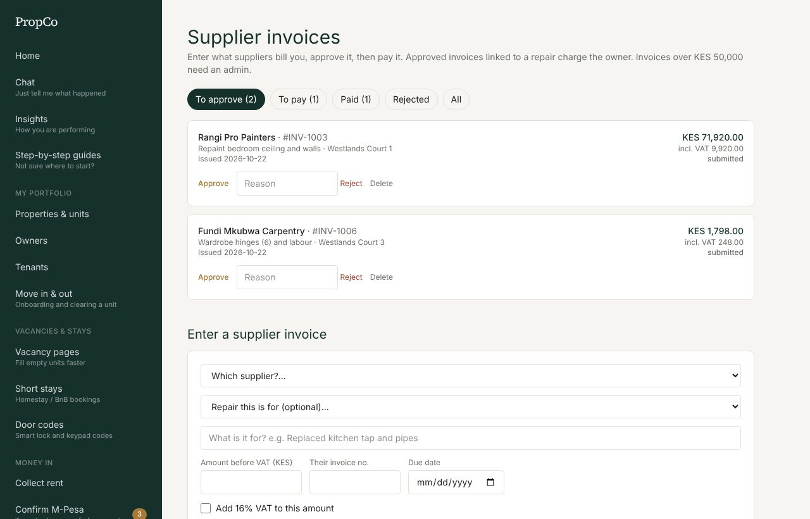
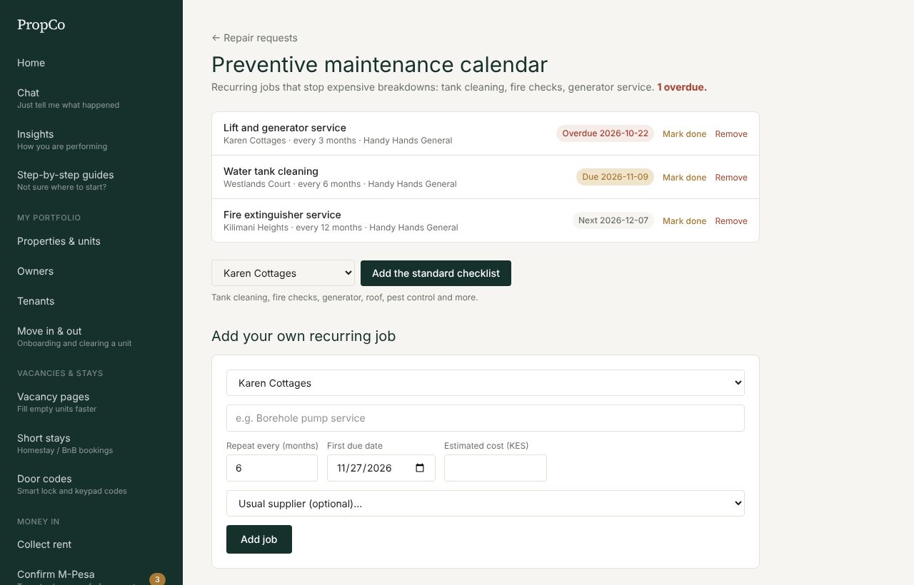

# 5. Repairs and suppliers

## Add your suppliers

Suppliers are the plumbers, electricians, carpenters, painters and others who do the work. Add each one once.

1. Open **Suppliers** and press **Add supplier**.
2. Choose their trade and enter their phone number (and M-Pesa number for paying them). Save.

## Log a repair

Every repair is tied to a unit so its cost lands with the right owner.

1. Open **Repair requests** and press **Log a request**.
2. Choose the **unit** and describe the problem. Add an estimate if you have one.
3. Save.

You can also type it in [Chat](02-chat.md): `Leak in unit 4B kitchen`.

## Assign, track and finish

Open a request to manage it.

1. **Assign**: pick a supplier and an estimated cost, then press **Assign**. The supplier is messaged with the job details.
2. **Photos**: press **Add a photo** to take a picture of the problem, and another when it is fixed. Photos are shrunk on your phone before upload.
3. **Mark complete**: when the work is done, type the **actual cost** and press **Mark done**. The final cost is taken off the owner's payout that month.

A request moves through **Open**, **Assigned**, **In progress** and **Done** (or **Cancelled**).

## Supplier invoices: enter, approve, pay

When a supplier sends a bill:

1. Open **Supplier invoices** and fill in **Enter a supplier invoice**: supplier, the repair it is for (optional but recommended), what it is for, the amount before VAT, their invoice number and due date. Tick **Add 16% VAT** if it applies.
2. A manager reviews it under **To approve** and presses **Approve** or **Reject** (with a reason).
3. Approved invoices move to **To pay**. Send the money, then mark it paid with the method and reference.

- **Approval limit:** invoices above your company's limit (set under Team and roles, Company details) can only be approved by an admin or someone with the "approve large invoices" permission.
- Approving an invoice linked to a repair sets the repair's cost, so the **owner is charged** in their payout.
- Paying it marks the repair paid, so it **cannot be paid twice**.

Use **Pay suppliers** for jobs paid without an invoice: it lists completed jobs, and you mark each paid with a reference.

## Preventive maintenance

Open **Preventive calendar** for recurring jobs such as fire extinguisher service, water tank cleaning and lift servicing. Set how often each repeats and who does it. Overdue jobs show a number on the menu so they are not forgotten.

