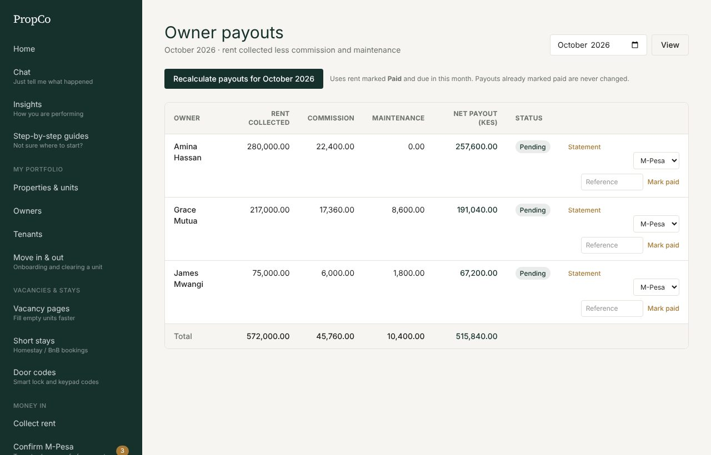
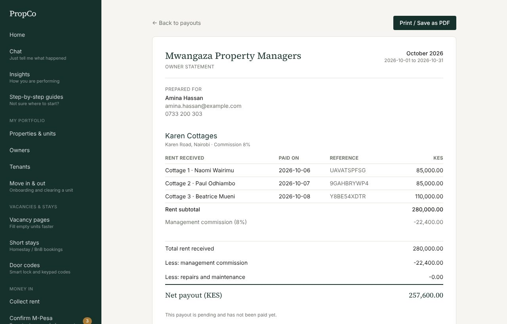

# 6. Paying owners

If you manage properties for other people, each month you pay each owner the rent collected, less your commission and any repair costs. PropCo works the numbers out for you.

## How a payout is worked out

```
Rent collected (marked Paid, due this month)
 - Your commission (the % on each property, default 10%)
 - Repairs you paid for the owner (jobs completed this month)
 = Net payout to the owner
```

## Generate the month's payouts

1. Open **Owner payouts** and choose the month.
2. Press **Generate payouts for [month]**.
3. Look over each owner's row: rent collected, commission, maintenance and the final amount.



- You can press **Recalculate** later (for example after recording a missed payment). It updates payouts that are still **Pending**.
- A payout already marked **Paid** is **never changed**.
- If a payment was missed, record it in [Collect rent](04-collecting-rent.md) and recalculate.

## Send the money and mark it paid

1. Send the money yourself by M-Pesa or bank.
2. On the owner's row, choose the **method**, type the **reference**, and press **Mark paid**.
3. The owner is told it is on the way, and the payment appears in your [Books](07-books-and-insights.md).

## Owner statements

Each payout has a **Statement** link: a print-ready breakdown of rent received per unit, commission, repairs and the net amount. Press **Print / Save as PDF** to share it.



Owners who have a PropCo login see their own payouts and statements, read-only.

## Self-managed properties

If a landlord manages their own property there is no payout: they collect rent directly and use PropCo for tracking, repairs and books.
