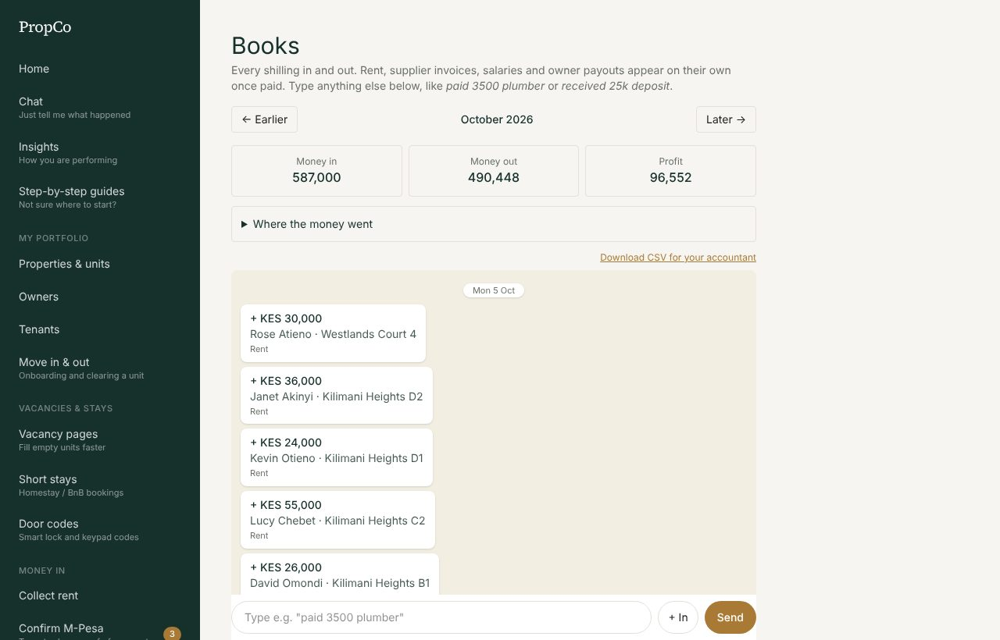
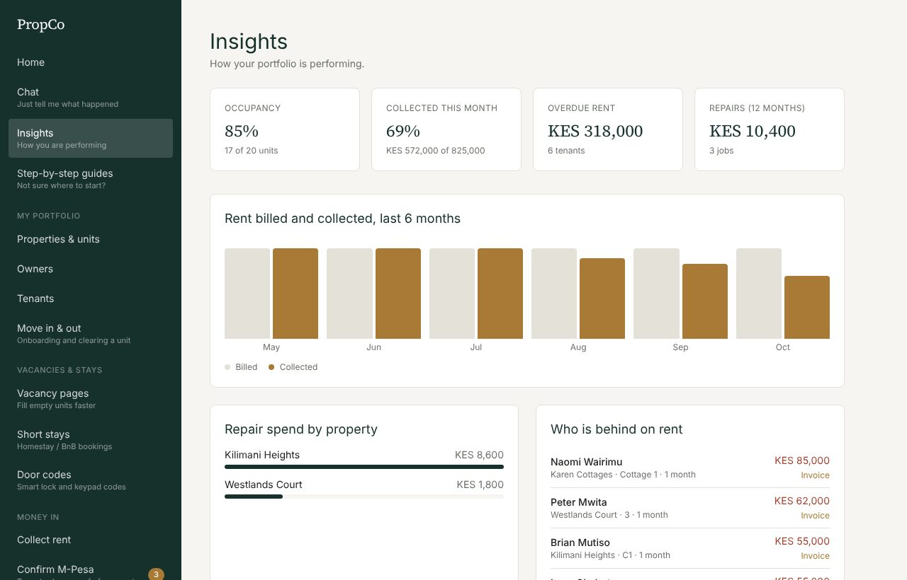
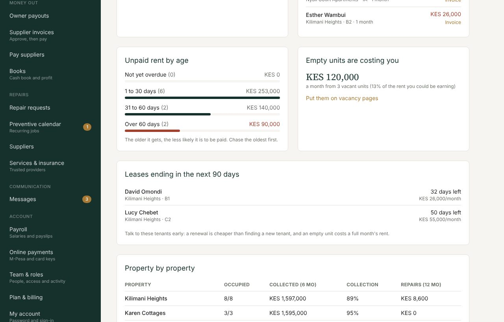

# 7. Books and Insights

## Books: what came in, what went out

**Books** is a cash book. It combines money PropCo already knows about with anything you type in.

- **Appears automatically** once paid: rent, supplier invoices, salaries and owner payouts. You never enter these twice.
- **You type**: anything else, such as fuel, airtime, cleaning, permits or parking fees.

### What you hold and owe

Three tiles sit under the month totals: **Held for owners**, **Owed to suppliers** and **Rent owed to you**. Tap *Held for owners* to see, for each landlord you manage, rent collected less your commission, completed repairs and payouts already sent. That money is theirs: keep it aside until you pay it out. A CSV download is on that page.

### Agents and commissions

If agents bring you tenants, add them under **Agents** with their commission (a share of the first month's rent, or a fixed amount). When you create a lease, choose the agent. The commission becomes due when the tenant pays their first rent, appears on **Today**, and *Mark paid* adds it to Books as "Agent commission".

### Add an entry

Type in the message box at the bottom, for example:

- `paid 3500 plumber`
- `received 25k deposit`
- `bought soap 800`

PropCo reads the amount, decides if it is money in or out, and picks a category. Press **Send**. Use **+ In** if you want to force it to be money in. Press **remove** under an entry you typed to delete it (automatic entries come from their own screens).

### Read the month

- **Money in**, **Money out** and **Profit** (or Loss) for the month at the top.
- **Where the money went** (tap to expand) shows spending by category.
- Use **Earlier** and **Later** to change month.
- **Download CSV for your accountant** gives a spreadsheet of the month.

Books needs the **books** permission. Admins have it; give it to an accountant through [Team and roles](10-team-and-security.md).

## Insights: where you stand

Open **Insights** for a picture of how the portfolio is performing.

| Card or chart | What it tells you |
|---|---|
| **Occupancy** | How many units are occupied |
| **Collected this month** | Rent received as a share of rent due |
| **Overdue rent** | Total owed and how many tenants |
| **Repairs (12 months)** | What repairs cost you |
| **Rent billed and collected, 6 months** | Trend: are tenants paying more or less reliably? |
| **Who is behind on rent** | The largest debts, with a link to send an invoice |

Scroll for more:

| Section | What it tells you |
|---|---|
| **Unpaid rent by age** | Not yet overdue, 1 to 30, 31 to 60 and over 60 days. The older, the less likely to be paid, so chase the oldest first |
| **Empty units are costing you** | The rent you lose each month from vacant units, with a link to put them on vacancy pages |
| **Leases ending in 90 days** | Talk to these tenants early: a renewal costs less than finding a new tenant |
| **Property by property** | Occupancy, rent collected, collection rate (red under 80%) and repair spend for each property |
| **Money in and out** | Six months of in against out, with the net (needs the books permission) |
| **Rental income tax estimate** | See below |

### The tax estimate

For Kenyan residential rent, PropCo shows an **estimate** of Monthly Rental Income tax: 7.5% of the rent collected so far this year, applying for landlords whose yearly rent is between KES 288,000 and KES 15 million. It is a planning aid only. Rates and rules change, the tax belongs to the property owner, and it is due by the 20th of the following month. **Confirm with KRA or your accountant before you file.**
