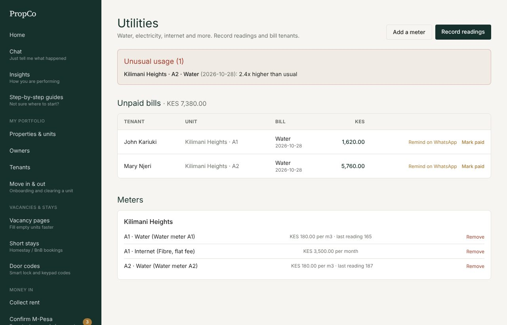
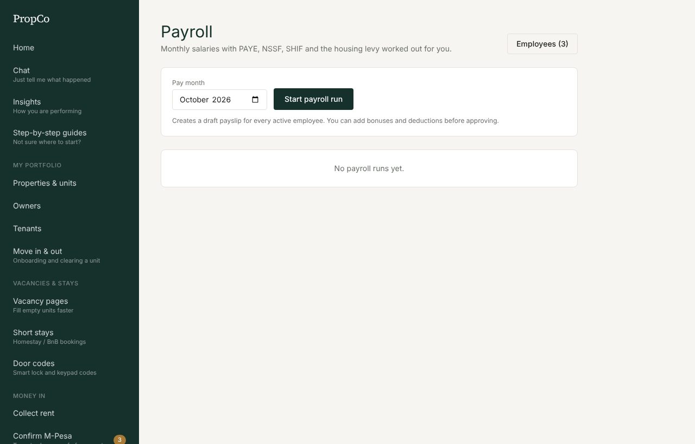
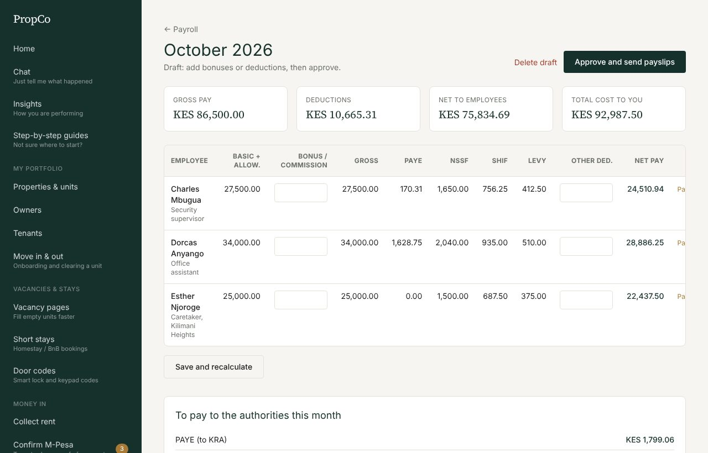

# 8. Utilities and payroll

Both are available during the free trial and on paid plans.

## Utilities: water, electricity, internet

Set meters up once, then record readings each month. PropCo bills the tenant and messages them.

### Add a meter or service

1. Open **Water, power and internet** and press **Add a meter**.
2. Choose the unit and what it is (water, electricity, internet, gas).
3. Pick **By meter reading** (a rate per unit, such as KES 180 per m3) or **Flat monthly fee** (such as KES 3,500 for internet).
4. Type the rate and save.

### Record the monthly readings

1. Press **Record readings** and choose the property.
2. Type each meter's current reading. Leave a meter blank to skip it.
3. Save. Bills are created automatically (current reading minus the previous one, times the rate) and tenants are told.

When a tenant moves in, choose **Opening readings for a new tenant** so they are billed only for their own use.

### Unusual usage

If a reading is much higher than usual (for example "2.4x higher than usual") it appears in a red **Unusual usage** box. It can mean a leak or a faulty meter, so check it before the tenant gets a surprise bill.

### Collect what is owed

Unpaid bills stay under **Unpaid bills**. Use **Remind on WhatsApp** for late payers and **Mark paid** when the money arrives. Unpaid utilities also appear on the tenant's invoice.

## Payroll

For paying your own staff (caretakers, guards, office staff). Admin only.

1. Open **Payroll** and press **Employees** (top right). Add each person: name, job title, basic salary, allowances, and how they are paid (M-Pesa or bank). Add their KRA PIN and NSSF/SHIF numbers for the statutory returns.
2. Each month, choose the **pay month** and press **Start payroll run**. This creates a draft payslip for every active employee, with **PAYE, NSSF, SHIF and the housing levy** worked out automatically.
3. On the draft run, add bonuses or deductions (loans, advances).
4. Press **Approve and send payslips**. Then pay each employee and press **Mark paid** against their payslip. Printable payslips are available.
5. The run shows a **to pay the authorities** summary so you can make your statutory payments on time.

> **Check the rates.** The statutory rates in PropCo are labelled "2026, verify with KRA, NSSF and SHA before use". Always confirm them with your accountant. Payroll is sensitive: only people with the payroll permission can see it.

Paid salaries appear in [Books](07-books-and-insights.md) on their own.
