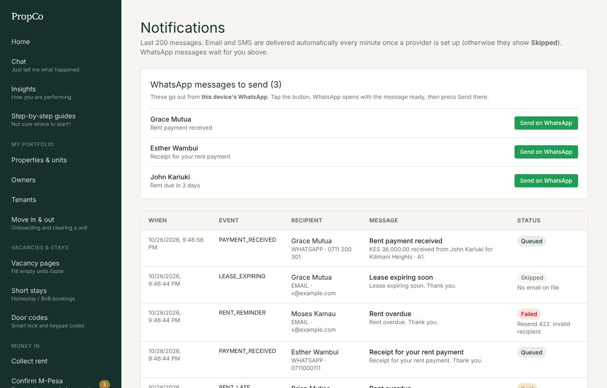

# 9. Messages and WhatsApp

PropCo sends messages for you when things happen. Each owner, tenant, supplier and employee has a **Notify via** setting (email, SMS or WhatsApp) on their page.

## What gets sent

| Event | Who is told |
|---|---|
| Rent payment received | The owner (and a receipt for the tenant) |
| Rent due soon, due today, 3 and 7 days late | The tenant |
| Payout sent | The owner |
| Lease ending in 60 days | The owner and the tenant |
| Repair assigned | The supplier |
| Repair done | The owner and the tenant |
| Supplier paid | The supplier |
| Utility bill created | The tenant |
| Plan or trial ending soon | Your company's admins |

## The Messages screen

Open **Messages** to see everything sent, waiting or failed.

| Status | Meaning |
|---|---|
| **Sent** | Delivered through email or SMS |
| **Queued** | Waiting to be sent. Email and SMS send within a minute |
| **Failed** | The provider refused it (for example an invalid address). PropCo retries a few times before marking it failed |
| **Skipped** | Nothing could be sent: the person has no phone or email on file, or no email/SMS provider is set up |

## WhatsApp: you tap Send

WhatsApp messages are sent from **your own phone**, so you need no business account.

1. Make sure the person's **Notify via** is **WhatsApp** and their phone number is right.
2. Open **Messages**. Waiting messages show **Send on WhatsApp**. The number on the menu tells you how many are waiting.
3. Tap it. WhatsApp opens with the text already written. Press **Send** in WhatsApp.

The same works for rent reminders from [Chat](02-chat.md), receipts, invoices and vacancy links.

## Email and SMS

Email (through Resend) and SMS (through Africa's Talking) need keys set up by whoever runs your PropCo installation. Until then, messages show as **Skipped** so you can still see what would have been sent. Ask your administrator or PropCo support.
