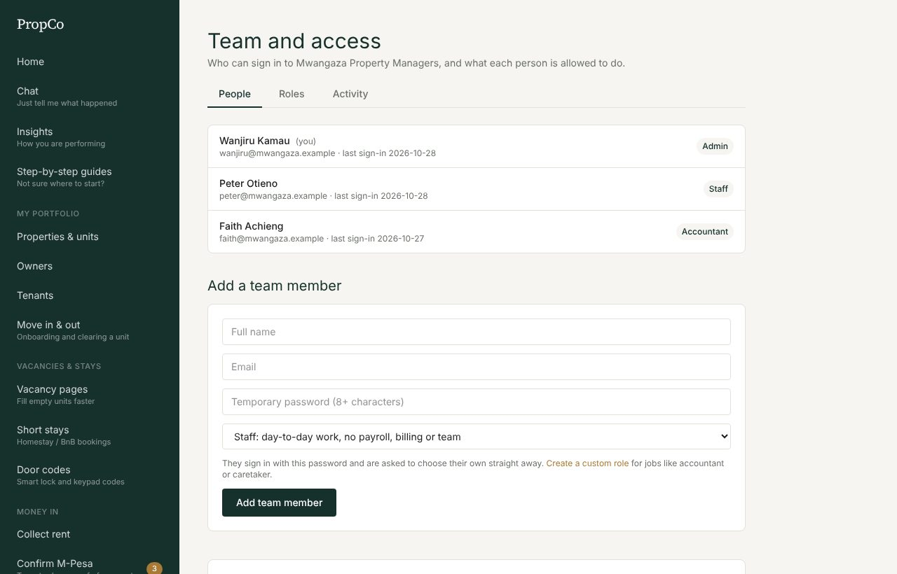
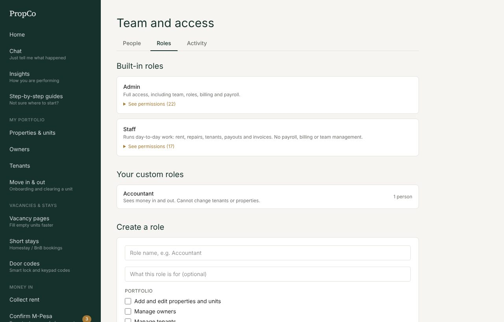
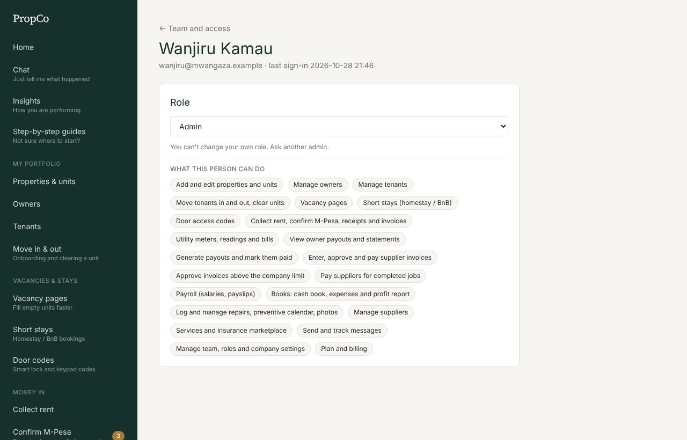
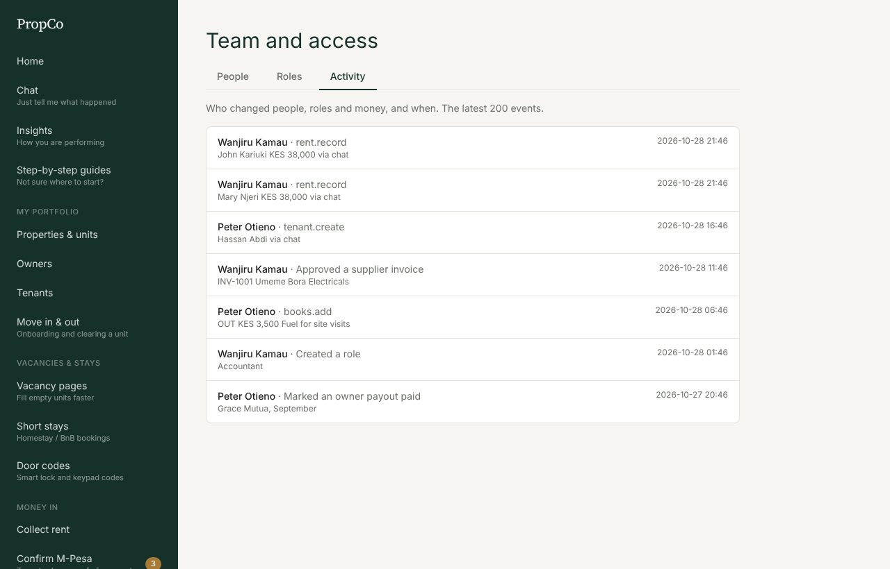

# 10. Team and security

Open **Team and roles** (admins only). It has three tabs: **People**, **Roles** and **Activity**.

## Add a person

1. On **People**, fill in **Add a team member**: full name, email and a **temporary password** (at least 8 characters).
2. Choose their **role** (see below) and press **Add team member**.
3. Give them the temporary password. They sign in with it and are asked to choose their own straight away.

## Roles and permissions

PropCo works on **permissions**, not job titles. Every screen and action checks a specific permission, and a role is a named set of permissions.

**Built-in roles**
| Role | What it can do |
|---|---|
| **Admin** | Everything, including team, roles, billing, payroll and books |
| **Staff** | Day-to-day work: rent, repairs, tenants, payouts, invoices. No payroll, billing, team or books |
| **Landlord** | A self-managing landlord: everything for their own properties only |
| **Owner** | Read-only view of their own properties, repairs and payouts |

**Custom roles.** Under **Roles**, press create a role, name it (for example "Accountant" or "Caretaker"), and tick exactly what it may do:

| Group | Examples |
|---|---|
| Portfolio | Properties and units, owners, tenants, leases, vacancy pages, short stays, door codes |
| Money in | Collect rent and confirm M-Pesa, utilities |
| Money out | View and run payouts, supplier invoices, approve large invoices, pay suppliers, payroll, **books** |
| Repairs and suppliers | Repairs and the preventive calendar, suppliers, services |
| Communication | Messages |
| Administration | Team and roles and company settings, plan and billing |

Then choose that role when adding or editing a person. Changes apply **immediately**, even if the person is already signed in.

Safety rules: you can only grant permissions you hold, only admins create admins, and the last active admin cannot be removed.

## Look after a person

Open a person to:
- **Change their role.**
- Press **Suspend access** (they are signed out on their next click) or **Restore access**.
- **Reset their password**: type a new temporary password. They must change it at their next sign-in.
- Press **Remove from team**.

If someone is **locked out** (five wrong passwords lock for 15 minutes), wait, or reset their password.

## Activity

The **Activity** tab is a log of who did what and when: people and role changes, payments, payouts, invoice approvals, payroll, and any action taken by **PropCo support** on your account (shown as "Support: name").

Use it to answer "who changed this?".

## Company details

At the bottom of the People tab, **Company details** holds your company name and two settings used across the app:
- **How to pay**: the text shown on tenant invoices (your paybill or till, account name, bank details).
- **Supplier invoice approval limit**: invoices above this amount need an admin to approve. Leave empty for no limit.

(The WhatsApp number that vacancy enquiries go to is set on the **Vacancy pages** screen.)

## Your own account

**My account** lets you change your password. Use a long password you do not use anywhere else, and never share it. If you forget it, ask your administrator to reset it, or contact PropCo support.
