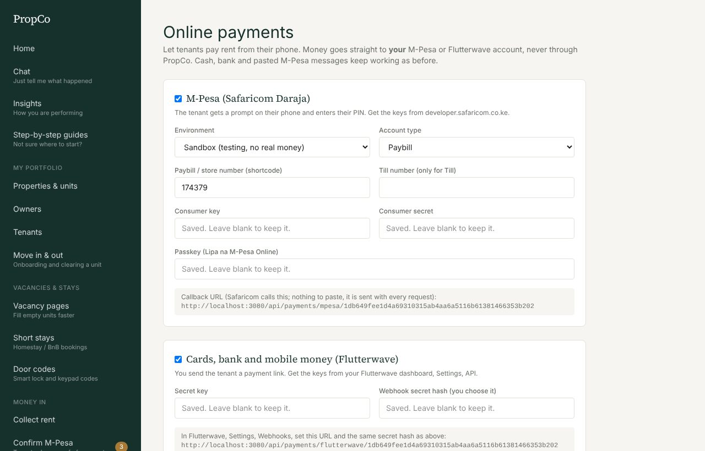
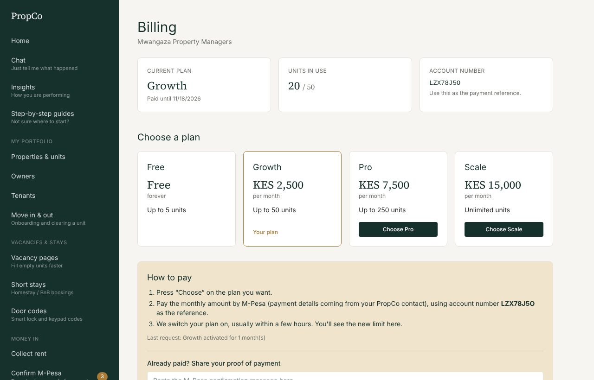
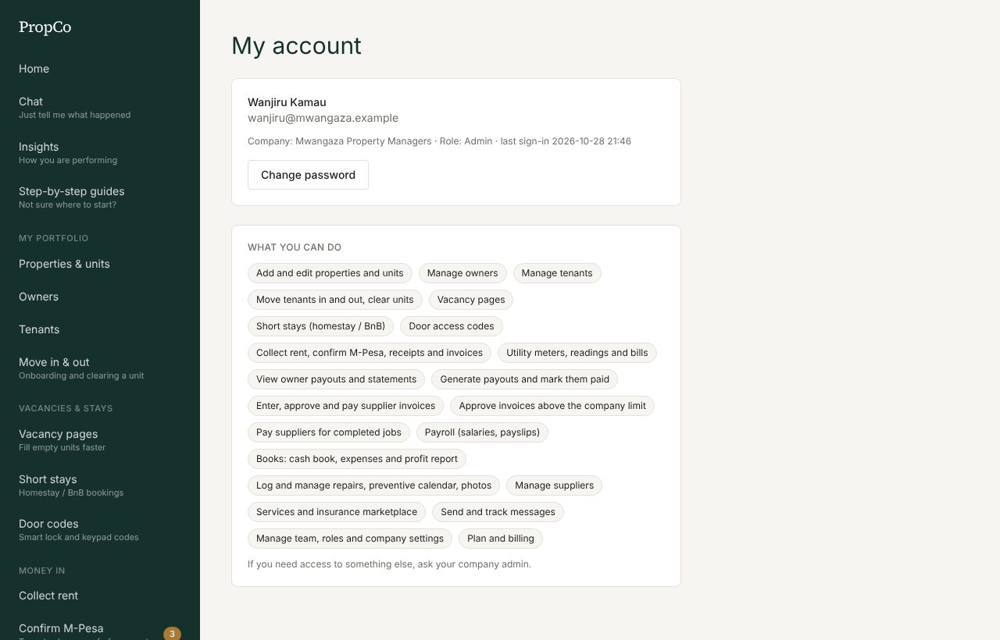
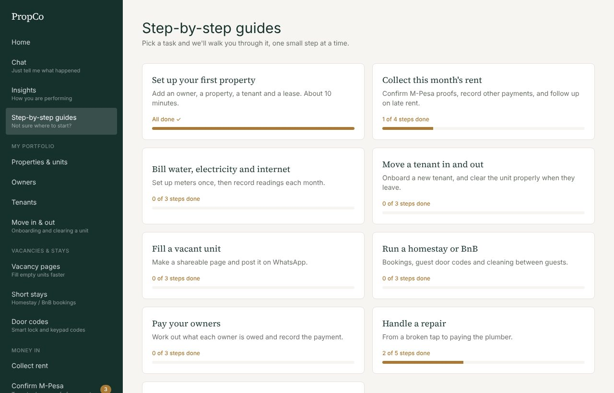

# 11. Online payments, billing and your account

## Online payments (admins)

Let tenants pay rent from their phone. Money goes straight to **your** M-Pesa or Flutterwave account, never through PropCo. Cash, bank and pasted M-Pesa messages keep working as before.

Open **Online payments** in the menu.

### M-Pesa (Safaricom Daraja)

The tenant gets a prompt on their phone and enters their PIN.

1. Get your keys from <https://developer.safaricom.co.ke>. Start in **Sandbox**, which uses no real money.
2. Tick **M-Pesa**, choose the environment and account type (**Paybill** or **Till**), and enter your shortcode (and your till number if you chose Till).
3. Paste the **consumer key**, **consumer secret** and **passkey**. Press **Save**.
4. Press **Test M-Pesa keys**. It signs in to Safaricom and moves no money.
5. When you are ready for real money, complete Safaricom's **Go Live** process, then switch to **Production** with your production keys.

Your PropCo address must be reachable from the internet over HTTPS, because Safaricom calls back with the result. The callback address is shown on the page and is sent with every request, so there is nothing to paste into Safaricom's portal.

### Cards, bank and mobile money (Flutterwave)

You send the tenant a payment link.

1. In your Flutterwave dashboard (Settings, API) copy the **secret key**. Choose a long random **secret hash**.
2. In Flutterwave (Settings, Webhooks) enter the **webhook URL** shown on the PropCo page, and the same secret hash.
3. In PropCo tick **Flutterwave**, paste the secret key and the secret hash, **Save**, then **Test Flutterwave key**.

### Good to know

- Keys are **stored encrypted** and never shown again. Leave a field blank to keep what is saved.
- You can use M-Pesa, Flutterwave, both, or neither.
- Every settings change is recorded in the activity log.
- To collect a payment, see [Collecting rent](04-collecting-rent.md#ask-for-payment-online). More detail for technical readers: [payments](../payments.md).

## Plan and billing (admins)

Open **Plan and billing** to see your plan, how many units you are using, and your **account number** (use it as the payment reference).

| Plan | Units | Price per month |
|---|---|---|
| Free | up to 5 | KES 0 |
| Growth | up to 50 | KES 2,500 |
| Pro | up to 250 | KES 7,500 |
| Scale | unlimited | KES 15,000 |

New companies get a **14-day free trial with everything unlocked**. After the trial, the Free plan covers 5 units and switches off utilities, move-in/out, door codes, short stays and payroll until you choose a paid plan. Your data is never deleted.

**To pay:**
- **Online:** if you see **Pay online** on a plan, choose M-Pesa (a prompt on your phone) or a card/bank link and the number of months. Your plan switches on by itself when the payment arrives.
- **By M-Pesa to PropCo's till:** press **Choose** on the plan, pay the monthly amount using your account number as the reference, then paste the M-Pesa message under **Already paid?**. PropCo switches your plan on, usually within a few hours.

You are warned before a trial or plan ends. If a plan expires, you drop to the Free limits; nothing is lost.

## My account

**My account** lets you change your password. Choose a long one you do not use elsewhere.

## Step-by-step guides

**Step-by-step guides** walks you through the main jobs (set up, collect rent, pay owners, handle a repair, move in and out, utilities, vacancies, short stays, WhatsApp). Steps tick themselves off as you complete them.

